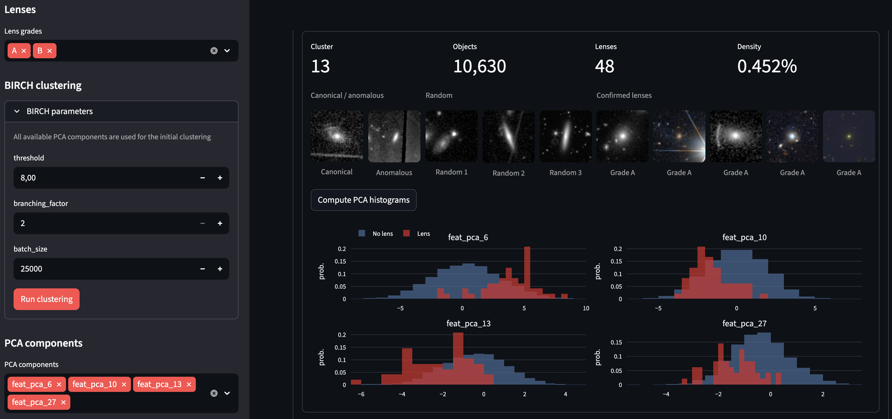
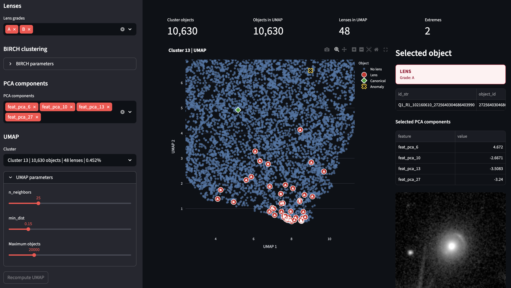

# ESCOPE

ESCOPE (Euclid Strong-lensing Candidate Observation and Projection Explorer) is a Streamlit web application for exploratory analysis of Euclid astronomical objects, morphology-based PCA representations, and labelled strong-lensing candidates.

The application is designed to help identify regions of morphology/PCA space that are enriched in strong-lens candidates, inspect those regions visually, and prioritize unlabelled objects that may be scientifically interesting for follow-up.

It does not classify objects as confirmed gravitational lenses. Instead, it provides an interactive analysis layer for clustering, dimensionality reduction, visual inspection, PCA thresholding, and candidate prioritization.

## Data Sources

The analysis uses Euclid Q1 catalogue products published on Zenodo:

- [Euclid Quick Data Release (Q1): First visual morphology catalogue](https://zenodo.org/records/15106473)
- [Euclid Quick Data Release (Q1): The Strong Lensing Discovery Engine](https://zenodo.org/records/15025832)

The app combines:

- Euclid visual morphology catalogue data.
- PCA representations, currently `feat_pca_0` through `feat_pca_39`.
- Catalogue morphology, photometric-redshift, stellar-population, flux, and shape measurements from `useful_physical_measurements.parquet`.
- A strong-lensing candidate catalogue.
- Morphology cutouts.
- Lens-candidate images, when available.

Objects are joined through `object_id`. Objects present in the strong-lensing catalogue are treated as labelled lens candidates; all other objects are treated as `Unknown`, not as confirmed non-lenses.

Runtime data is expected to be available through configurable paths:

- PCA representations: `PARQUET_PATH`
- Straight-line-artifact-filtered PCA representations: `STRAIGHT_LINE_FILTERED_PARQUET_PATH`
- Physical measurements: `PHYSICAL_MEASUREMENTS_PATH`
- Lens-candidate catalogue: `LENS_PATH`
- Morphology cutouts: `CUTOUT_BASE`
- Lens-candidate images: `LENS_IMG_BASE`
- Optional morphology catalogue: `MORPH_PATH`

The `data/` directories in this repository are placeholders for local development workflows.

## Lens Candidate Grades

The application supports strong-lens candidate grades `A`, `B`, and `C`.

- **Grade A**: secure or almost secure lens candidates with clear lensing features such as arcs, multiple images, or Einstein-ring-like structures.
- **Grade B**: probable lens candidates with visually compatible features that require additional confirmation.
- **Grade C**: possible lens candidates with lens-like morphology that may also be explained by other physical structures, such as spiral arms, galaxy interactions, or complex morphology.

The user can select which grades are included in the analysis. By default, grades `A`, `B`, and `C` are selected.

## Analysis Flow

The intended workflow is:

1. Run BIRCH clustering over all 40 standardized PCA components.
2. Compute lens-candidate density per cluster.
3. Inspect the clustering summary and its visual examples.
4. Select any cluster from the summary table or from a visual preview.
5. Review the selected cluster preview and its automatically generated PCA and physical-property characterizations.
6. Optionally apply recommended PCA and physical-property filters from the sidebar.
7. Visualize the filtered selected cluster with UMAP.
8. Apply hierarchical subclustering inside promising clusters.
9. Use `A/B/C` labels to guide semi-supervised UMAP within subclusters.
10. Prioritize `Unknown` objects near lens-rich labelled regions.

This workflow supports scientific triage: it narrows large Euclid catalogues to smaller, enriched regions where follow-up inspection is more efficient.

## Benchmark-Informed Defaults

BIRCH UI presets depend on the selected catalogue; UMAP retains the stability-benchmark defaults:

- **BIRCH**: all 40 standardized PCA components and `batch_size=25000`. The artifact-filtered catalogue starts at `threshold=5.5`, `branching_factor=42`; the complete catalogue retains `6.2/50`. Custom inputs are remembered separately for each catalogue.
- **Unsupervised UMAP**: the selected PCA components with standard scaling, `n_neighbors=10`, `min_dist=0.0`, Euclidean distance, and `random_state=42`.
- **Semi-supervised UMAP**: the selected PCA components with standard scaling, `n_neighbors=10`, `min_dist=0.15`, and UI-adjustable `target_weight` (`0.5` by default), using Euclidean input distance, categorical target distance, and `random_state=42`.

The initial BIRCH stage is strictly unsupervised: candidate labels are neither used to select its features nor passed to `fit`. Lens labels are used only after clustering to measure candidate density and enrichment. The lens-displaced components `6, 0, 12, 1, 27, 10, 8, 13` remain the default selection for downstream PCA filtering and UMAP exploration.

Physical measurements are joined by exact `object_id` only after BIRCH has been fitted. They can characterize clusters and subclusters, constrain the object set passed to UMAP, and enrich exported tables, but they do not alter the global morphology-based clustering.

The filtered preset ranked first in the 651-configuration descriptive enrichment sweep with support of at least 100 objects and 50 A/B/C references per cluster. It tied other settings at two clusters with at least 50x enrichment and won the grade-count tie-breaks; this is not a universal optimum or independent discovery validation. CLI/API defaults remain `6.2/50` for compatibility.

No downstream cluster is selected automatically. The summary initially ranks by labelled-candidate count, then density, then cluster size. All three criteria descend, with cluster ID ascending as a final tie-break. This initial order applies to the table, CSV, first 20 visual previews, and graph, without refitting BIRCH or adding support cuts. Column headers can reorder the displayed table only; previews, graph nodes, and CSV retain the initial order. Every cluster remains selectable from the complete table.

The summary table, cluster previews, selected-cluster view, and clustering CSV include `label_entropy_bits`: binary Shannon entropy of the selected-reference fraction `p = n_lenses / n_objects`, computed as `-p log2(p) - (1-p) log2(1-p)` with `0 log2(0) = 0`. It describes the original cluster before downstream filters. Its tooltip explains that both entirely labelled and entirely Unknown clusters have entropy zero, while a 50/50 mixture has one bit. Unknown objects are not confirmed non-lenses, and reference candidates are not all confirmed lenses. Entropy is a deterministic transform of the labelled fraction, not an independent validation measure or a measure of morphological compactness; it does not change clustering, ranking, or parameter selection.

## Cluster Profile Graph

The optional graph in the clustering summary relates the same first 20 previews using full-cluster catalogue medians. Defaults are concentration, asymmetry, smoothness, Gini, M20, and Sersic index; redshift and stellar mass are also available. Documented quality flags are applied, and each selected property needs at least 80% valid coverage in a cluster. Incomplete profiles are listed and excluded, not imputed.

Properties are standardized across all complete cluster profiles in the run, with equal weight and constant dimensions removed. Links are the undirected union of the nearest two profiles per displayed cluster (adjustable from one to four), using Euclidean distance in this standardized space. Reordering previews does not refit the scale. Enrichment colours nodes and object counts set their size; labels never enter distances. Screen distances from the seeded layout are not physical/profile distances. Available canonical cutouts are always displayed with cluster IDs and enrichment-coloured borders; they are the same PCA representatives as the previews, not objects with all median properties. Nodes without an available cutout retain their coloured marker. Hover summaries show property medians without coverage percentages; coverage checks are unchanged.

Enabling **Show morphological graph** builds it automatically with the default properties and two nearest profiles. Later property/neighbor edits are applied only with **Build / refresh graph**. The graph uses the first 20 initially ranked previews. Profiles are cached for one hour, keyed by the physical source generation (or local file metadata) and a full object-ID/membership hash. A source refresh checks that provenance again. Clicking a node opens its analysis directly. No graph-cluster selector, separate Analyse button, or graph-data download is shown.

## Multivariate Profile Views

Two independent switches display parallel coordinates: cluster medians below the clustering summary table, and individual object measurements below the selected-cluster preview. Both start disabled. Cluster scope defaults to the first 20 previews, with an all-cluster option; object scope defaults to the full cluster, with an active-PCA/physical-filter subset option. Properties and colour are independently configurable in each view. Cluster colours use enrichment, labelled fraction, A/B/C count, or entropy; object colours use catalogue grade/Unknown or a physical property. Unknown is not a confirmed non-lens.

The eight existing physical/morphological catalogue properties are available, initially showing the six morphology-graph properties. Cluster medians use all members and require 80% valid coverage on each selected property. Objects need valid measurements on every axis and on the colour property, if applicable. Catalogue quality flags apply, missing values are not imputed, and axes retain their original units. These are descriptive visualizations, not the notebook's regression models or an inpainting-suitability score.

Axis-range selections are inclusive, combined by OR within an axis and AND between axes. They filter a linked table without changing BIRCH, its metrics, initial preview order, or UMAP filters. Selecting a cluster row opens its analysis; selecting an object row displays its details. Reset restores the complete valid selection. Property, colour, scope, and dataset changes reset incompatible selections. Cluster profiles reuse the morphology graph's source-generation/full-membership cache.

Object charts draw at most 20,000 lines using the existing deterministic labelled-priority sampling policy (seed 42). Axis limits, colour limits, range-selection counts, and matching tables still use all complete profiles, not just that chart sample. Tables show at most 5,000 matching rows with an explicit truncation count; filtering can narrow the result further. Neither support rule nor missing-data filtering excludes a cluster for having a high labelled fraction.

## Features

- Loads PCA catalogues such as `representations_pca_40.parquet`.
- Optionally runs BIRCH on a PCA catalogue from which high-confidence straight-line image artifacts were removed.
- Optionally assigns excluded artifacts to the fitted BIRCH clusters for inspection without changing the clustering or lens-candidate statistics. Reports the distance from each assigned center.
- Automatically detects `feat_pca_*` columns.
- Derives `object_id` from `id_str` when required.
- Loads and joins a lens-candidate catalogue through `object_id`.
- Loads physical measurements on demand and joins them through exact `object_id`.
- Lets the user select lens grades included in the analysis.
- Runs BIRCH clustering using all 40 standardized PCA components.
- Computes cluster-level lens-candidate density.
- Lets the user select any cluster directly from the clustering table, including clusters beyond the visual-preview limit.
- Provides visual previews for the first 20 ranked clusters with:
  - canonical object;
  - anomalous object;
  - random cluster examples;
  - labelled lens candidates.
- Collapses the clustering summary after selection and displays only the selected cluster preview in the main analysis flow.
- Automatically computes PCA histograms comparing `Lens candidate` vs `Unknown` for the selected cluster.
- Estimates PCA threshold recommendations that enrich lens candidates in a cluster.
- Applies recommended PCA filters interactively.
- Automatically displays compact physical characterization for the selected cluster, with medians, interquartile ranges, coverage, and eight histograms arranged four per row.
- Restricts physical characterization to photometric redshift, stellar mass, concentration, asymmetry, smoothness, Gini, M20, and Sersic index.
- Recommends one-sided physical-property thresholds when enough valid lens and unknown measurements are available.
- Applies optional quality-aware physical-property filters from the sidebar before UMAP without refitting BIRCH.
- Computes UMAP embeddings for selected clusters.
- Uses a shared UMAP legend for Grade A (small red circles), Grade B (small
  orange squares), Grade C (small yellow crosses), and Unknown (blue) objects.
- Computes hierarchical subclusters inside the selected cluster.
- Computes semi-supervised UMAP for selected subclusters using labels `A=2`, `B=1`, `C=0`, and unknown objects as `-1`.
- Supports object search by `object_id`.
- Shows object metadata, selected PCA values, morphology-catalogue features, physical measurements, and available cutouts.
- Links selected/search objects to Aladin for external sky inspection.
- Includes an offline notebook for experimental arc-like-structure detection.
- Supports CSV export of clustering summaries, searched objects, and selected UMAP objects, including matched physical measurements.

## Screenshots

### Clustering Summary



### UMAP Explorer



## Visual Analytics

The app provides several complementary visualizations:

- Cluster summary table with object counts, lens-candidate counts, and lens-candidate density.
- Visual cluster rows with canonical, anomalous, random, and labelled lens-candidate examples.
- PCA histograms comparing labelled lens candidates against unknown objects.
- Recommended PCA thresholds shown as vertical dashed lines on the histograms.
- Interactive Plotly UMAP of the selected cluster.
- UMAP overlays for lens candidates, canonical objects, anomalous objects, and hierarchical subclusters.
- Semi-supervised UMAP for subclusters guided by `A/B/C` candidate labels.
- Dendrogram preview to guide the number of hierarchical subclusters.
- Compact cluster and subcluster physical-property summaries and distributions.
- Cutout inspection for selected or searched objects.
- Offline evaluation workflow for curve-aware arc-like-structure detection.

## PCA Threshold Recommendations

For each displayed PCA component, the app evaluates candidate thresholds of the form:

```text
feat_pca_X >= threshold
feat_pca_X <= threshold
```

For each threshold, it reports:

- retained objects;
- retained lens candidates;
- `lens_rate_%`;
- `enrichment_x`;
- `recall_%`.

`lens_rate_%` is the fraction of retained objects that are labelled lens candidates.

`enrichment_x` measures how much the lens-candidate density improves after applying the filter compared with the full cluster. For example, if a cluster has `0.5%` lens candidates and a PCA filter returns a subset with `5.0%` lens candidates, the enrichment is `10x`.

`recall_%` measures what fraction of the cluster's labelled lens candidates are retained by the filter.

These thresholds are exploratory prioritization tools. They should not be interpreted as definitive classification rules.

## Experimental Arc-Like Structure Detection

Arc-like structure detection is being evaluated offline with representative Euclid cutouts. The controls are currently hidden in the application while a curve-aware algorithm is calibrated and validated. The [experimental Colab notebook](notebooks/euclid_arc_like_structure_detection_v2_colab.ipynb) combines multiscale background subtraction with polar geometry, tangential alignment, angular-span measurements, and straight-feature rejection.

This experimental output is a visual prioritization aid, not a lens classifier. Spiral arms, edge-on galaxies, diffraction artifacts, interacting systems, and noise can still produce false positives.

## Scientific Use

Strong gravitational lenses are rare. Searching for them in large imaging surveys requires efficient prioritization strategies. ESCOPE helps by combining morphology-space clustering, labelled-candidate density, PCA filtering, and visual inspection.

The app can help answer questions such as:

- Do known lens candidates cluster in specific regions of Euclid morphology/PCA space?
- Which clusters are enriched in `A`, `B`, or `C` lens candidates?
- Which PCA components separate labelled candidates from unknown objects?
- Which unknown objects are close to known candidates in UMAP space?
- Do enriched clusters contain smaller substructures with even higher candidate density?
- Are `Grade C` candidates distributed as ambiguous bridge populations between confident candidates and the wider galaxy population?
- Which unlabelled objects should be prioritized for visual inspection or follow-up modelling?

## Guiding Unsupervised Lens Discovery

The outputs of the app can be used to guide unsupervised or weakly supervised gravitational-lens discovery workflows.

A practical strategy is:

1. Run BIRCH clustering over the catalogue using all 40 standardized PCA components.
2. Rank clusters by lens-candidate density.
3. Inspect enriched clusters visually.
4. Compute PCA histograms and threshold recommendations.
5. Apply PCA filters to isolate enriched regions.
6. Compute UMAP for the filtered cluster.
7. Run hierarchical subclustering to identify compact subregions.
8. Use semi-supervised UMAP to assess how labelled candidates shape the local projection.
9. Export unknown objects close to lens-rich regions.
10. Review those objects visually and in Aladin.
11. Feed prioritized candidates into visual inspection, active learning, anomaly detection, or downstream lens-modelling workflows.

This makes the app useful as a bridge between labelled strong-lens catalogues and unsupervised discovery. Labelled candidates act as anchors, while the unknown population is searched for objects that occupy similar morphology-space regions.

## Configuration

Set the required catalogue and image paths through environment variables:

```bash
export PARQUET_PATH="gs://<bucket>/catalogues/morphology_catalogue/representations_pca_40.parquet"
export STRAIGHT_LINE_FILTERED_PARQUET_PATH="gs://<bucket>/catalogues/morphology_catalogue/representations_pca_40_artifacts_filtered_v3_2_continuous_multiscale_hough_lines.parquet"
export PHYSICAL_MEASUREMENTS_PATH="gs://<bucket>/catalogues/morphology_catalogue/useful_physical_measurements.parquet"
export LENS_PATH="gs://<bucket>/catalogues/strong_lensing_catalogue/q1_discovery_engine_lens_catalog.csv"
export CUTOUT_BASE="gs://<bucket>/catalogues/morphology_catalogue/cutouts_jpg_gz_arcsinh_vis_only"
export LENS_IMG_BASE="gs://<bucket>/catalogues/strong_lensing_catalogue/lens"
export EUCLID_USE_LOCAL_CACHE=0
```

Optional variables:

```bash
export MORPH_PATH="gs://<bucket>/catalogues/morphology_catalogue/morphology_catalogue.parquet"
export EUCLID_CACHE_DIR="$HOME/.cache/euclid-umap-explorer"
```

`MORPH_PATH` is used to display the full morphology-catalogue row for selected or searched objects when available. `PHYSICAL_MEASUREMENTS_PATH` supplies the separately joined physical context, cluster summaries, UMAP filters, and export columns.

`EUCLID_USE_LOCAL_CACHE=0` disables copying catalogue files into the local cache.

## Local Setup

Python 3.11 is required.

```bash
python3.11 -m venv .venv
source .venv/bin/activate
pip install --upgrade pip
pip install -r requirements.txt
```

Configure the environment variables and start Streamlit:

```bash
streamlit run app.py
```

## Cloud Run Deployment

Example deployment command:

```bash
gcloud run deploy euclid-umap-app \
  --source . \
  --region europe-west1 \
  --allow-unauthenticated \
  --memory 4Gi \
  --cpu 2 \
  --timeout 900 \
  --set-env-vars=PARQUET_PATH=gs://<bucket>/catalogues/morphology_catalogue/representations_pca_40.parquet,PHYSICAL_MEASUREMENTS_PATH=gs://<bucket>/catalogues/morphology_catalogue/useful_physical_measurements.parquet,LENS_PATH=gs://<bucket>/catalogues/strong_lensing_catalogue/q1_discovery_engine_lens_catalog.csv,CUTOUT_BASE=gs://<bucket>/catalogues/morphology_catalogue/cutouts_jpg_gz_arcsinh_vis_only,LENS_IMG_BASE=gs://<bucket>/catalogues/strong_lensing_catalogue/lens,EUCLID_USE_LOCAL_CACHE=0
```

The `Dockerfile` runs Streamlit on the Cloud Run `$PORT`.

## Repository Layout

```text
.
├── app.py
├── requirements.txt
├── Dockerfile
├── README.md
├── assets/
├── docs/
├── euclid_umap_explorer/
└── data/
    ├── morphology/
    ├── strong_lenses/
    └── cutouts/
```
